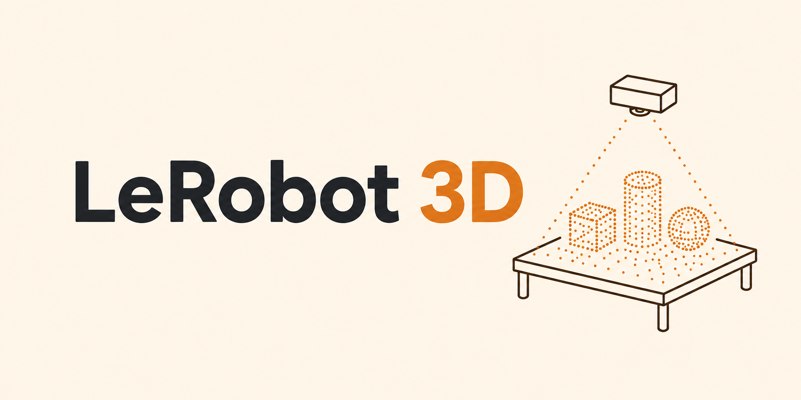
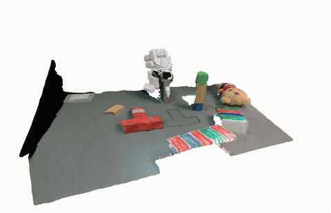
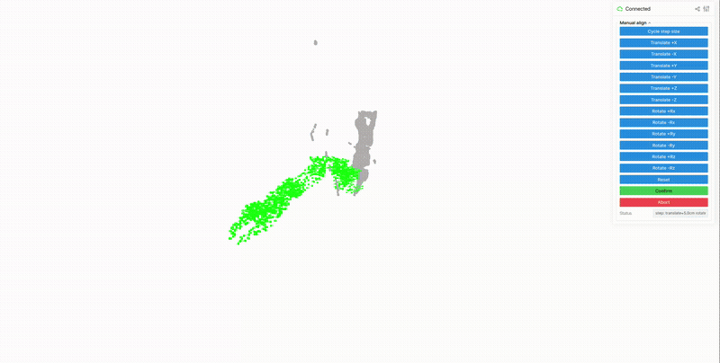

<p align="center">
  
</p>

# LeRobot 3D

A 3D-grounded SO101 teleoperation stack: multiple RealSense cameras fused into one live scene point cloud, the robot's own URDF tracked alongside it via forward kinematics, and camera-to-robot calibration solved with ICP against that same mesh — all driven from one browser session via [viser](https://viser.studio/).

- **Teleop** — N SO101 leader→follower pairs, one or more RealSense cameras fused into a single scene point cloud per frame, config-driven (`teleop_config.yaml`), no code changes needed.
- **3D viewer** — a viser browser UI rendering the fused scene, the full robot point cloud, and a per-link breakdown, all updating live, plus GUI buttons for capture/save-subgoal/quit.
- **Calibration** — camera extrinsics solved by manually aligning a masked robot point cloud onto the robot's own URDF mesh, then refined with multi-scale ICP; intrinsics and robot arm motor calibration are handled alongside.
- **Extensible** — a small Python API (`TeleopSystemConfig`, `TeleopPointCloudSystem`, `SystemStateViewer`) for building custom capture/recording scripts on top.

<p align="center">
  
</p>

## Why `LeRobot 3D`?

Robots operate in 3D, but most accessible robot learning and teleoperation pipelines still primarily operate on 2D camera observations. For many tasks, we care about the geometry of the scene relative to the robot: where objects are, what is reachable, what is occluded, and where collisions may occur.

`lerobot_3d` makes this 3D grounding a first-class part of the LeRobot stack. It aligns multiple depth cameras with the robot, fuses their observations into a shared 3D point cloud, and tracks the robot's URDF geometry in the same coordinate frame. The goal is to provide a simple, reusable foundation for 3D-aware robot learning instead of rebuilding camera calibration and 3D visualization infrastructure for every project.


## Install

```bash
pip install -e ".[realsense]"
```

(`realsense` pulls in `pyrealsense2`, required to stream RealSense cameras.)

## YAM URDF and mesh calibration

`examples/yam_viser.py` renders saved poses from the I2RT YAM v1 / linear_4310
station URDF and exports mesh targets for the existing calibration workflow.
Use I2RT revision `120c3c81400171174604e503943f8d1ebc891058` and its
`i2rt/robot_models/station/yam_station_linear_4310_d405/yam_station_linear_4310_d405.urdf`.

```bash
python examples/yam_viser.py view --urdf "$YAM_URDF" --state pose.json
python examples/yam_viser.py export-gripper --urdf "$YAM_URDF" --side left --gripper-open 1 --output calibration_files/robot_pcd.npz
```

State JSON contains `mode` (`live` or `synthetic`) and `arms.left`/`arms.right`,
each with six `position_rad` values and `gripper_open` (0 closed, 1 open).
`export-mesh` uses `--state`/`--output`; measured states additionally require
`stationary_capture_confirmed: true`. Gripper targets use metres in the named
gripper frame; the fitted transform is camera-to-gripper. Prepare rectified,
registered images with depth in millimetres for the existing ICP reader.
Nominal mounts and synthetic poses are not calibrated transforms or live feedback.

### Live YAM viewer (ROS 2)

Read-only live view in viser: measured joints from `/joint_states` (`<side>_joint1..6` rad, optional
`<side>_joint7` finger travel in m) pose the station URDF, and each wrist camera's image and depth cloud
are drawn at its URDF camera link (nominal mount until calibrated). Needs `rclpy`.

```bash
python -m lerobot_3d.point_clouds.yam_live_viewer --urdf "$YAM_URDF"
```

Each `--camera NAMESPACE=LINK` (default `/camera/left_wrist=left_camera`, `/camera/right_wrist=right_camera`)
reads `color/image_raw/compressed`, `depth_raw/image_rect_raw/compressedDepth` (lossless PNG), both
`camera_info` topics, and depth-to-color extrinsics from `/tf_static`. `--stride`, `--max-depth` and
`--point-size` tune the clouds.

## Teleop (`lerobot-teleop`)

Drives **N SO101 follower** arms from **N SO101 leader** teleoperators while streaming **one or more Intel RealSense** cameras, fusing depth into a scene point cloud, sampling the first follower's URDF for a robot point cloud, and rendering all of it live in **viser**.

```bash
lerobot-teleop
```

| Flag | Meaning |
|------|---------|
| `--config PATH` | Teleop config YAML (see below). Omit to use the default `teleop_config.yaml`. |
| `--hz 60` | Main loop rate in Hz (default `60`). Use `0` or negative for no pacing. |

Everything else — recording, extrinsics path, RealSense serials, camera resolution/FPS, the tune panel, the viser port — lives in `teleop_config.yaml`, not on the command line. Run `lerobot-teleop -h` for the full flag list.

Open `http://localhost:<viser_port>` (default `8080`) in a browser to see the fused scene point cloud, the full robot point cloud, and a per-link robot point cloud per URDF link, all updating live. With `tune: true` in the config, the same page shows **Quit** / **Capture** / **Save subgoal** buttons — Quit stops the main loop cleanly, Capture snapshots calibration images (see [Performing calibration](#performing-calibration)), Save subgoal writes the current fused scene to `subgoals/`.

## Teleop configuration

Everything — hardware wiring **and** run settings — lives in **`teleop_config.yaml`**, not in Python. A dev-checkout copy ships at `src/teleop_config.yaml`:

```yaml
leaders:
  - port: /dev/ttyACM0
    id: bender_leader_arm
followers:
  - port: /dev/ttyACM3
    id: bender_follower_arm
realsense_serials:
  - "244622072067"

extrinsic_json: extrinsic_calibration.json
tune: true
camera_width: 848
camera_height: 480
camera_fps: 60
viser_port: 8080
```

`leaders`/`followers` must be the same length when both are set (matched by list position). Each of `leaders`, `followers`, and `realsense_serials` may be empty (`[]`):

- **No leaders** — there's no teleop. Drive the system from your own script with `system.step(action)` (see below). The `lerobot-teleop` CLI exits with an error in this mode.
- **No followers** — nothing is commanded. The action (from the first leader or `step(action)`) poses the URDF in viser as a digital twin. Its calibration comes from `robot_calibration_ids`/`robot_calibration_paths`, else the first leader's LeRobot calibration.
- **No cameras** — no RealSense streams and no extrinsics file needed. The scene point cloud is empty.
- **No leaders *and* no followers** — `num_robots` virtual robots (default 1), each posed by its own entry in `step([a0, …, aN-1])` and laid out on a grid in viser, `robot_grid_spacing` meters apart (default 0.5). See [Multiple virtual robots](#multiple-virtual-robots).

See `src/teleop_config.yaml` for the full, annotated field list (recording, URDF/calibration overrides, camera stream, smoothing) and `lerobot_3d.teleop_config.TeleopSystemConfig` for the underlying dataclass.

**Resolution order** for both `teleop_config.yaml` and the extrinsics JSON: an environment variable (`LEROBOT_3D_TELEOP_CONFIG` / `LEROBOT_3D_EXTRINSIC_JSON`) → the current working directory → `src/<file>` next to the installed package (dev checkout).

## Recording a LeRobotDataset

Set `dataset_repo_id` in `teleop_config.yaml` to record teleop episodes into a [LeRobotDataset](https://github.com/huggingface/lerobot):

```yaml
dataset_repo_id: local/my_task   # empty disables recording
dataset_root: null               # null -> HF_LEROBOT_HOME/<repo_id>; an existing dataset is appended to
dataset_task: teleop             # task string stored with every frame
dataset_fps: 15                  # the teleop loop runs at this rate while recording is configured
```

Then run `lerobot-teleop` and use the terminal (it needs focus):

- **Enter** — start an episode.
- **Space** — end it. You're asked `Keep? [y/n]`: **y** saves it (encodes video), **n** discards it.
- Quitting (viser **Quit** or Ctrl+C) discards an unsaved episode and finalizes the dataset.

Teleop and the viser view keep running in every state. If a step can't keep up with `dataset_fps`, a warning is printed. Recorded timestamps assume a fixed rate, so lower `dataset_fps` (or the camera resolution) if you see it.

Each frame stores (`<serial>` = camera serial, `<link>` = URDF link name):

| key | shape | contents |
|---|---|---|
| `action` | `(J,)` float32 | motor-space action sent to the follower |
| `observation.state` | `(J,)` float32 | follower joint positions (motor space) |
| `observation.images.<serial>` | video `(H, W, 3)` | RGB |
| `observation.depth.<serial>` | image `(H, W, 3)` | uint16 depth packed losslessly into R (high byte) / G (low byte) |
| `observation.depth_scale.<serial>` | `(1,)` float32 | meters per depth unit |
| `observation.intrinsics.<serial>` | `(3, 3)` float32 | color camera K (depth is aligned to color) |
| `observation.extrinsics.<serial>` | `(4, 4)` float32 | `X_WC`, camera → world |
| `observation.robot_link_pcds.<link>` | `(N, 3)` float32 | world-frame link points. Point `k` of a link is the same body point in every frame. |

Joint names are in `meta/info.json` (`features.action.names`). A sidecar file, `meta/lerobot_3d.json`, records the depth encoding, camera serials, link names and frame conventions.

`lerobot_3d.recording.dataset_loader` turns a frame back into the live pipeline's `Datapoint`s (BGR color, raw uint16 depth, intrinsics, `X_WC`). Fusion, masking and segmentation code then works on recorded data unchanged:

```python
from lerobot.datasets.lerobot_dataset import LeRobotDataset
from lerobot_3d.point_clouds.camera_stream import get_fused_point_cloud
from lerobot_3d.recording.dataset_loader import frame_link_pcds, frame_to_datapoints

ds = LeRobotDataset("local/my_task", root="path/to/dataset")
item = ds[0]
datapoints = frame_to_datapoints(item)            # set dp.obj_mask per camera to segment
scene_pcd, _ = get_fused_point_cloud(datapoints)  # world-frame fused cloud
links = frame_link_pcds(item)                     # {link_name: (N, 3)} world frame
```

To record from your own loop (e.g. with `step(action)`), use `LeRobotDatasetRecorder` directly: `start_episode()`, `add_frame(datapoints, robot_states[0], action)`, `stop_episode()`, then `save_episode()` or `discard_episode()`, and `finalize()` at the end.

### Pushing a dataset to the Hugging Face Hub

1. Log in once with a token that has write access (`hf auth whoami` checks who you're logged in as):
   ```bash
   hf auth login
   ```
2. Make sure `dataset_repo_id` is `<your-hf-username>/<name>` (e.g. `Sorozco0612/pusht`), not `local/...`: the repo id is the Hub repo the dataset is pushed to.
3. Quit `lerobot-teleop` first so the dataset is finalized, then push:
   ```bash
   python -c "from lerobot.datasets.lerobot_dataset import LeRobotDataset; LeRobotDataset('Sorozco0612/pusht').push_to_hub(private=True, upload_large_folder=True)"
   ```
   Pass `root=...` to `LeRobotDataset` if you set `dataset_root`. This creates the dataset repo if needed, uploads everything under the dataset root except the temporary `images/` folder (including the `meta/lerobot_3d.json` sidecar), writes a dataset card, and tags the revision with the LeRobot codebase version. `upload_large_folder=True` uploads in resumable chunks. Use it, because depth frames make these datasets several GB. Drop `private=True` to make the dataset public.

Pushing again after recording more episodes re-uploads the changed files. Anyone can then load it with `LeRobotDataset("Sorozco0612/pusht")`, which downloads it on first use.

## Performing calibration

<p align="center">
  
</p>

**Robot arm motor calibration** (homing/joint limits) is handled by LeRobot itself, not this repo — run `lerobot-calibrate` for each leader/follower arm. Point `teleop_config.yaml`'s `robot_calibration_dir` / `robot_calibration_ids` / `robot_calibration_paths` at the resulting JSON if it isn't in LeRobot's default location.

**Camera intrinsics** are written automatically to `intrinsic_calibration.json` (in the working directory) on every **Capture** and when `lerobot-teleop` shuts down; each connected camera's entry is added or refreshed, and entries for other cameras are kept.

**Camera extrinsics** (each RealSense's pose relative to the robot base) are the main calibration workflow:

1. **New camera, no existing entry?** Bootstrap `extrinsic_calibration.json` with an identity transform for its serial:
   ```json
   {
     "YOUR_SERIAL": {
       "X_WC": [[1, 0, 0, 0], [0, 1, 0, 0], [0, 0, 1, 0], [0, 0, 0, 1]]
     }
   }
   ```
2. Run `lerobot-teleop`, position the robot arm in view of the camera(s) you're calibrating, and click **Capture** in the viser GUI. This writes `calibration_files/<serial>/{color.png,depth.npz}` per camera and `calibration_files/robot_pcd.npz` (the robot mesh point cloud at that pose).
3. **Segment the robot** — right after **Capture** saves the images, the follower(s) move back (over ~3 s) to the pose they were in when `lerobot-teleop` started, then an OpenCV window opens for each camera's `color.png`: **left-click** on the robot (positive points), **right-click** on background SAM2 grabbed by mistake (negative points), and watch the green overlay update. **Enter**/**Space** saves `calibration_files/<serial>/mask.png`; **u** undoes the last point, **r** clears them, **s**/**Esc** skips the camera. The teleop loop pauses meanwhile; once you're done, the follower eases (~2 s) from that pose back to the leader instead of jumping. This needs SAM2: `pip install -e ".[segment]"` (the checkpoint, `sam2_model_id` in `teleop_config.yaml`, downloads from Hugging Face on first use); set `segment_on_capture: false` to turn it off. `icp.py` reads the mask's **alpha channel** (opaque = robot, transparent = background) and zeroes out depth outside it. You can still make the mask by hand, e.g. with [Segment Anything (web)](https://huggingface.co/spaces/Xenova/segment-anything-web), whose transparent-background cutout uses the same convention. A camera without a `mask.png` is skipped (see `discover_calibration_serials`, which requires both `depth.npz` and `mask.png`).
4. From the same directory (containing `calibration_files/`, `extrinsic_calibration.json`, `intrinsic_calibration.json`), run:
   ```bash
   python -m lerobot_3d.icp
   ```
5. For each camera, the viser GUI shows translate/rotate buttons (±X/±Y/±Z), a step-size cycle button, reset, confirm, and abort — nudge the point cloud onto the robot mesh, then **Confirm**. ICP then refines the confirmed pose automatically and shows the result for a second confirm/abort.
6. Once every camera is done, all of them are shown together in color over the robot mesh, in a **Review / fine-tune merged result** panel. Pick a camera in the **Camera** dropdown and nudge it with the same buttons to line it up against the other cameras (**Reset** undoes that camera's nudges only). **Confirm** keeps the fine-tuned poses. **Abort** keeps the poses from step 5.
7. The refined `extrinsic_calibration.json` is written back — ready for `lerobot-teleop`.

## Custom teleop script

Build a **`TeleopSystemConfig`** (`lerobot_3d.teleop_config`) with **`SO101AxisConfig`** entries for each **leader** and **follower** (`port` + LeRobot `id`), **`realsense_serials`**, and any optional fields you need (`urdf_path`, `robot_calibration_ids`, `camera_width`, `camera_height`, `camera_fps`, `tune`, `viser_port`). `len(leaders)` must equal `len(followers)` when both are non-empty. `robot_calibration_ids` defaults to each follower's `id`; the **first** follower's observation drives the mesh/point-cloud visualization returned as `robot_pcds[0]`/`robot_link_pcds[0]`.

Call `step()` each tick for `datapoints` (`list[Datapoint]`, one per camera — `.color`/`.depth`/`.color_intrinsics`/`.X_WC` etc., see `lerobot_3d.common.types.Datapoint`), `scene_pcd` (Open3D point cloud — `np.asarray(scene_pcd.points)`/`.colors`), and three per-robot lists (one entry per visualized robot — just one with leaders/followers): `robot_pcds` (`(M, 3)` `float64` each), `robot_link_pcds` (`dict[str, np.ndarray]` keyed by URDF link name), and `robot_states` (`lerobot_3d.common.types.RobotSnapshot` — `.joint_positions` (motor-space), `.joint_radians`, `.pcd`, `.link_pcds`, `.link_poses`, `.base_offset`). Robot clouds and poses are in each robot's **own base frame**. Call `close()` when `system.viewer.quit` is set:

```python
import time

from lerobot_3d.control.teleop import TeleopPointCloudSystem
from lerobot_3d.teleop_config import load_teleop_system_config

if __name__ == "__main__":
    hz = 15.0
    period_s = None if hz <= 0 else 1.0 / hz

    config = load_teleop_system_config("./my_teleop_config.yaml")

    system = TeleopPointCloudSystem(config)
    system.connect()
    try:
        while not system.viewer.quit:
            t0 = time.monotonic()
            datapoints, scene_pcd, robot_pcds, robot_link_pcds, robot_states = system.step()
            # use datapoints / scene_pcd / robot_pcds / robot_link_pcds / robot_states here
            if period_s is not None:
                time.sleep(max(0.0, period_s - (time.monotonic() - t0)))
    finally:
        system.close()
```

To bypass the leaders (or when none are configured), pass `step(action)` a list of motor-space dicts (`{"shoulder_pan.pos": ..., "gripper.pos": ...}`), one per follower. With no followers, pass one per virtual robot (`num_robots`, default 1); they pose the URDFs only:

```python
action = {"shoulder_pan.pos": 0.0, "shoulder_lift.pos": 0.0, "elbow_flex.pos": 0.0,
          "wrist_flex.pos": 0.0, "wrist_roll.pos": 0.0, "gripper.pos": 50.0}
system.step([action])
```

### Multiple virtual robots

With no leaders and no followers, set `num_robots` to visualize several robots at once. Each one is posed by its own action and drawn on an evenly spaced grid in viser. Robot 0 stays at the origin, so a calibrated camera scene still lines up with it. `robot_calibration_ids` takes a single id shared by every robot, or one id per robot.

```yaml
leaders: []
followers: []
realsense_serials: []
num_robots: 4
robot_grid_spacing: 0.5
robot_calibration_ids: [gray_follower_arm]
```

```python
datapoints, scene_pcd, robot_pcds, robot_link_pcds, robot_states = system.step([a0, a1, a2, a3])
robot_states[2].joint_radians   # robot 2's joint angles
robot_states[2].base_offset     # where viser draws it; robot_pcds[2] is NOT offset
```

`step()` also takes an optional `masks_by_serial` (a `{serial: mask}` dict or a list aligned with `realsense_serials`; nonzero/`True` pixels are kept) to mask the fused point cloud per camera.

For a fully custom stack (different robot type, no `TeleopPointCloudSystem`), build directly on **`SO101Leader`**/**`SO101Follower`** from LeRobot and **`SystemStateViewer`** in `lerobot_3d.point_clouds.system_vis`, passing a `TeleopSystemConfig` and calling `update(*actions)` with one dict per follower each tick (or one per virtual robot with no followers).

## Citation

If you use `lerobot_3d` in your work, please cite the repository:

```bibtex
@misc{orozco2025lerobot3d,
    author = {Orozco, Sergio},
    title = {LeRobot 3D},
    howpublished = "\url{https://github.com/SergioMOrozco/lerobot_3d}",
    year = {2025}
}
```

This project builds on [LeRobot](https://github.com/huggingface/lerobot); consider citing it too.

## Contributing

Contributions are welcome — see [CONTRIBUTING.md](CONTRIBUTING.md) for setup instructions, how to run tests/lint, and a roadmap of ideas if you're looking for something to work on.
